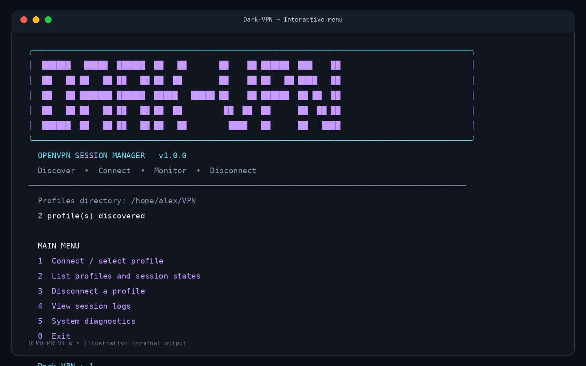
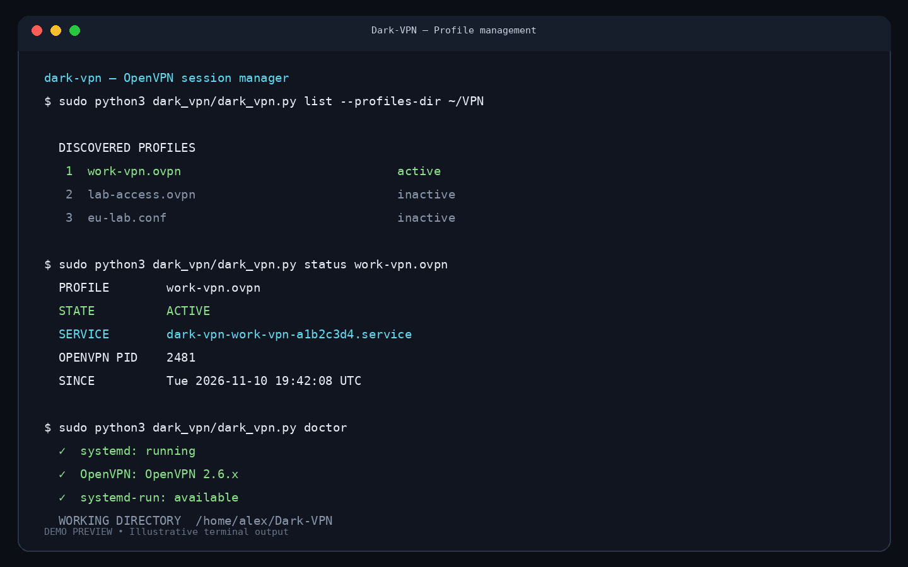

# Dark-VPN

<p align="center">
  <strong>A clean, interactive OpenVPN session manager for Linux.</strong><br>
  Discover profiles, connect, disconnect, inspect status, and view logs from one terminal interface.
</p>

<p align="center">
  
  
  
  
</p>

## Preview





## Features

- Interactive terminal menu with a themed ASCII banner.
- Automatically discovers `.ovpn` and OpenVPN-format `.conf` profiles.
- Start, stop, inspect, and view logs for individual VPN sessions.
- Uses **systemd transient services** to supervise OpenVPN in the foreground.
- Supports multiple profiles; be aware that simultaneous VPNs can conflict over routes and DNS.
- No Python third-party packages required.
- Configurable profile directory.

## Requirements

- Linux with **systemd** running as PID 1.
- Python 3.10 or newer.
- OpenVPN installed.
- `systemctl`, `systemd-run`, and `journalctl`.
- `sudo` access for starting and stopping VPN services.

> This release is designed for systemd-based Linux distributions (for example Kali, Debian, Ubuntu, Fedora, and Arch when using systemd). It does not currently support Windows, macOS, WSL without systemd, or non-systemd init systems.

## Installation

### 1. Install system dependencies

Debian / Ubuntu / Kali:

```bash
sudo apt update
sudo apt install -y openvpn python3
```

Fedora:

```bash
sudo dnf install -y openvpn python3
```

Arch Linux:

```bash
sudo pacman -S openvpn python
```

### 2. Clone the repository

```bash
git clone https://github.com/abhishekdpandey18/Dark-VPN.git
cd Dark-VPN
```

### 3. Run

```bash
python3 dark_vpn/dark_vpn.py --help
python3 dark_vpn/dark_vpn.py
```

The default profile directory is the current working directory. To use a dedicated directory:

```bash
python3 dark_vpn/dark_vpn.py --profiles-dir ~/VPN
```

Or set it once in your shell:

```bash
export DARK_VPN_PROFILES_DIR="$HOME/VPN"
```

## Usage

Launch the interactive menu:

```bash
sudo python3 dark_vpn/dark_vpn.py --profiles-dir ~/VPN
```

CLI commands (run from the folder containing your profiles, or pass an absolute profile path):

```bash
sudo python3 dark_vpn/dark_vpn.py list
sudo python3 dark_vpn/dark_vpn.py start my-profile.ovpn
sudo python3 dark_vpn/dark_vpn.py status my-profile.ovpn
sudo python3 dark_vpn/dark_vpn.py logs my-profile.ovpn
sudo python3 dark_vpn/dark_vpn.py logs my-profile.ovpn --follow
sudo python3 dark_vpn/dark_vpn.py stop my-profile.ovpn
python3 dark_vpn/dark_vpn.py doctor
```

See all options:

```bash
python3 dark_vpn/dark_vpn.py --help
```

## How it works

Dark-VPN starts OpenVPN as a foreground process managed by a transient systemd service. It does not daemonize OpenVPN itself. This lets systemd track the process and stop the service cleanly.

Service names are generated from the profile name and its resolved path, helping avoid collisions between identically named profiles in different directories.

## Important notes

- **Only use VPN configuration files from providers and networks you trust.** OpenVPN profiles can contain directives that execute external scripts or load plugins.
- A successful service start does not guarantee that all traffic is routed through the VPN. Check routes, DNS, and your public IP separately.
- Running multiple VPN profiles at once can create competing default routes, DNS changes, or overlapping subnets.
- Dark-VPN does not provide VPN servers, accounts, configuration files, or credentials.
- Do not commit private `.ovpn` files, certificates, keys, or credentials to a public repository.

## Troubleshooting

Run diagnostics:

```bash
python3 dark_vpn/dark_vpn.py doctor
```

Inspect a session:

```bash
sudo python3 dark_vpn/dark_vpn.py status my-profile.ovpn
sudo python3 dark_vpn/dark_vpn.py logs my-profile.ovpn
```

If a profile fails to start, check that it works with OpenVPN directly and inspect the service journal. Ensure systemd is running and that the profile's referenced certificate/key files are accessible.

## Project structure

```text
Dark-VPN/
├── dark_vpn/
│   ├── __init__.py
│   ├── __main__.py
│   └── dark_vpn.py
├── screenshots/
│   ├── menu.png
│   └── profiles.png
├── .gitignore
├── CONTRIBUTING.md
├── LICENSE
├── README.md
└── SECURITY.md
```

## Contributing

Bug reports, feature requests, and pull requests are welcome. Please read [CONTRIBUTING.md](CONTRIBUTING.md) before submitting changes.

## License

Released under the MIT License. See [LICENSE](LICENSE).
